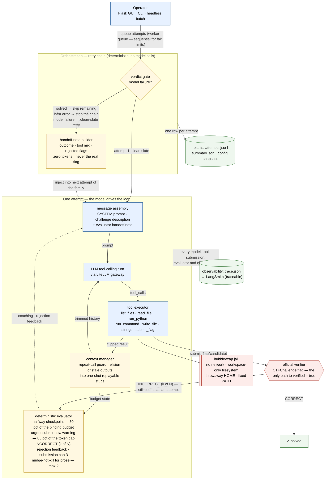
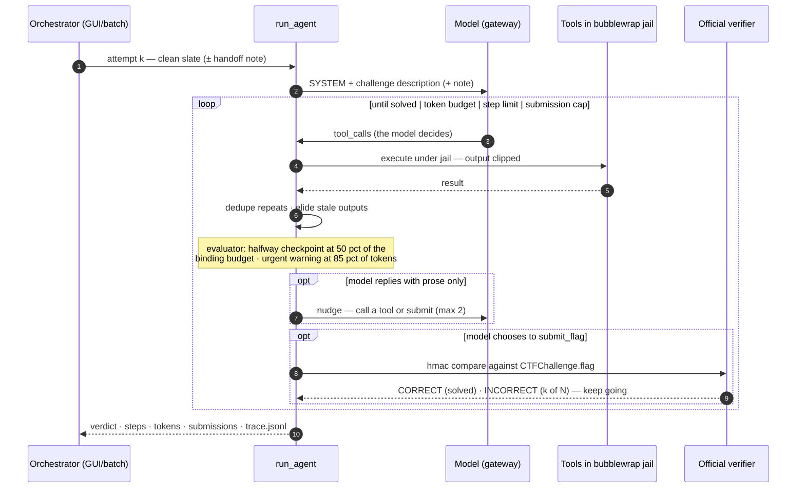

# Agent architecture — mapped to Anthropic's *Building Effective Agents*

This document maps the ctf-agent harness onto the design guidance in
[Building Effective Agents](https://www.anthropic.com/research/building-effective-agents)
(Anthropic, Dec 2024). The one-sentence summary of that essay: **start with the
simplest thing that works** — often a single LLM call or a composed workflow — and
reach for a full **agent** (a model driving a tool loop on environmental feedback)
only when the task demands it, keeping every added pattern simple, transparent,
and verifiable.

Our target domain (rev/crypto/misc CTF challenges under a hard token budget) is
exactly the essay's case for an agent: open-ended, multi-step, no known procedure
in advance — so the core of this project *is* the essay's canonical agent loop.
Everything else we added is thin, deterministic guardrails around that loop.

## 1. System diagram

Reading guide:

- **The center is the model loop** (`MSG → MODEL → EXEC → CTX → MODEL`): the LLM
  decides every step; nothing in the harness scripts its behavior. This is the
  essay's "agent" — *models using tools in a loop based on environmental feedback*.
- **Yellow nodes are deterministic guardrails.** They never call the LLM, never
  invent content, and only (a) inject short coaching messages, (b) trim context,
  or (c) enforce hard stops (budgets, submission cap).
- **Red edges/nodes are the integrity boundary.** Tool execution is jailed
  (bubblewrap); the real flag lives only in the official verifier — `verified=true`
  is reachable *exclusively* by submitting a candidate through `submit_flag`.
- **The dashed edge from the handoff-note builder** is the evaluator-optimizer
  loop *between* attempts: retries of the same challenge receive a distilled
  summary of the failed attempt (what was tried, what was rejected, where it left
  off). Batch/scored runs deliberately skip this edge so pass@k stays honest.

## 2. One attempt, as a sequence

## 3. Mapping: essay recommendation → this project

| Anthropic recommendation | How this project implements it |
|---|---|
| **Agents** = model in a loop, acting on environment feedback | `run_agent`: one chat loop; the model picks from 7 tools every turn; the harness only tracks budgets and relays results |
| **Start simple; add complexity only when it pays** | No planners, no multi-agent, no RAG. Complexity was added one guardrail at a time, each kept because a measured failure motivated it (REPORT §3): elision → token deaths; evaluator → 7 of 11 deaths with no submission; retries repeating trajectories |
| **Workflows vs agents** — don't over-orchestrate | The *only* orchestration (retry chains, batch trials) is deterministic Python, never model-driven. Attempts are sequential — parallel workers would break fair time-based limits |
| **Evaluator-optimizer** pattern | Implemented *deterministically* (no judge LLM, zero extra tokens): in-run — halfway checkpoint, urgent near-limit warning, rich `INCORRECT (k of N)` feedback, submission cap; between attempts — handoff notes distilled from the failed trace |
| **Prompt chaining** | The SYSTEM prompt encodes verified tool facts (pipes allowed, redirects blocked, tail truncation, notes-file habit) so the model doesn't burn steps rediscovering the interface; the loop appends step-proximity coaching, not blind re-prompts |
| **Tool design (ACI)** matters as much as the model | Small toolset with documented, sandboxed semantics; outputs clipped at the tail with a stub marker; repeat-call guard gives immediate, actionable errors ("you already ran this exact call") instead of silent repetition |
| **Ground truth & verification** | The benchmark's official flag check is the *only* success signal (hmac compare, outside agent context). The agent can see a verdict, never the answer — so `verified=true` cannot be gamed |
| **Transparency** | Every model/tool/submission/evaluator/elision event is appended to `trace.jsonl` (first line `meta` stamps the exact run limits; last line `done` states the outcome) and mirrored to LangSmith; `attempts.jsonl` records every attempt including retries |
| **Human control points** | Config tab (model, limits, retries, handoff notes — persisted visibly), fixed-limit snapshots (`config.json`) per results set, retry gating the human chose ("repeat only when the model fails") |
| **Guardrails around the agent** | Token/step/time budgets; nudge cap; submission cap; elision at 50% of the token cap; bubblewrap jail (no network, workspace-only FS) as the security boundary |

## 4. What we deliberately do *not* do (per the essay)

- **No orchestrator-workers or parallelization** — sequential attempts keep
  time-based limits fair and results comparable.
- **No LLM-as-judge** — the essay's evaluator-optimizer uses a model in a loop;
  our evaluator is pure code. Same feedback channels, zero token cost, fully
  deterministic and testable.
- **No multi-agent / planner-executor splits** — a single strong loop with good
  tools beat those on this benchmark's budget profile; scaffolding beyond the
  loop was only added when a trace-proven failure demanded it.
- **No hidden state** — the agent's whole world (staged files, description,
  clipped outputs, evaluator notes) is visible in the trace and never includes
  benchmark answers.
